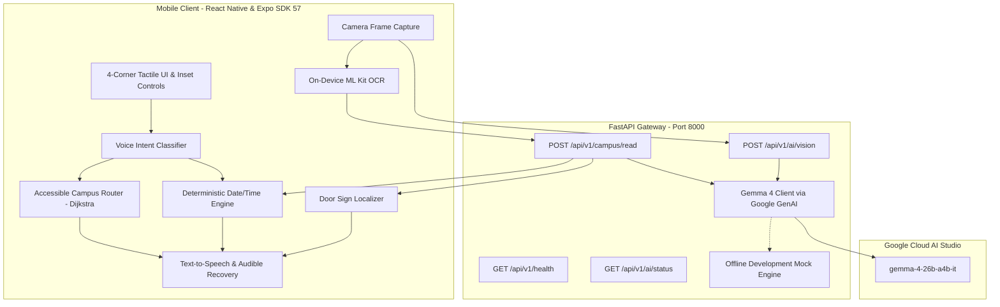
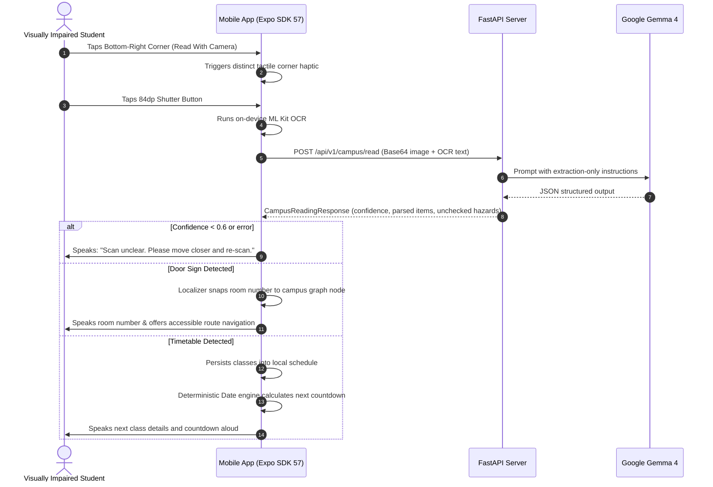

# SAARTHI — Campus Mode: Complete Project Context

**Generated On:** 2026-10-25  
**Project Root:** `./`  
**Target Assistant:** AI Pair Programmer / Assistant continuing development

---

## 1. Project Overview

### Project Name & Purpose
- **Name:** **SAARTHI — Campus Mode** (often referred to as Saarthi).
- **Purpose:** An accessible, multimodal AI navigation, schedule reasoning, and reading assistant engineered specifically for blind and low-vision university students.

### Problem Statement & Target Users
- **Target Users:** Blind and low-vision students and staff navigating university campuses, academic buildings, lecture halls, and dormitories.
- **The Problem:** 
  1. University campuses present unpredictable physical barriers (stairs, construction, narrow corridors, unmapped obstacles).
  2. Visual-only campus infrastructure (printed class timetables, paper noticeboards, room door plaques) causes daily friction, disorientation, and missed classes.
  3. Standard multimodal LLMs frequently hallucinate room numbers, directions, and perform unreliable temporal math ("when is my next class?"), posing physical and safety hazards to visually impaired users.

### Proposed Solution & How It Works
SAARTHI implements a **hybrid, deterministic safety-first architecture**:
1. **Multimodal Extraction (LLM / Vision)**: Google Gemma 4 (`gemma-4-26b-a4b-it`) and on-device ML Kit OCR extract raw observations, door plaques, and printed timetable text into structured JSON.
2. **Deterministic Plain-Code Reasoning (Zero LLM Hallucinations)**:
   - **Campus Navigation**: Deterministic Dijkstra shortest path algorithm with an **avoid-stairs** wheelchair and accessibility flag. If only stairs exist, it refuses to fabricate an accessible path.
   - **Schedule Reasoning**: Strict application calendar logic computes next-class countdowns and dates. LLMs never calculate dates or distances.
3. **Fail-Safe & Fail-Audible**: Every AI response carries a confidence score (`0.0`–`1.0`). If confidence falls below threshold (< 0.6) or an error occurs, an audible spoken message instructs the user to re-scan.
4. **4-Corner Tactile UI**: Inset touch targets (> 56dp) fixed in the four screen corners with distinct haptic patterns (`expo-haptics`) to avoid iOS/Android system gesture conflicts.

### Unique Selling Points & Innovation
- **Extraction vs. Reasoning Separation**: AI models only extract raw text/observations; plain code calculates routes, countdowns, and decisions.
- **Conservative Spatial Assertions**: The app never claims "the path is clear." It explicitly reports what was detected and notes unchecked zones (ground drop-offs, out-of-frame hazards).
- **Offline / Local Mock Engine**: Development mock mode allows testing the complete UI and routing workflows without cloud API dependencies.
- **Survey CSV to Graph Pipeline**: CLI converter converting simple CSV physical survey templates into schema-validated campus routing graphs.

### Hackathon Theme / Track
- **Track**: Google Gemma / Gemini AI Multimodal Developer Challenge — Accessibility & Assistive Technology.
- **Core Model**: `gemma-4-26b-a4b-it` (Google Gemma 4 open weights multimodal model via Google GenAI SDK).

### Current Development Stage
- **Stage:** **Functional MVP / Working Prototype (Alpha)**.
- Backend FastAPI service is complete with 43 passing automated tests.
- React Native / Expo SDK 57 mobile client is complete with 42 passing unit tests and strict TypeScript verification.

---

## 2. Features Matrix

| Feature | Group | Status | Key Source Files | Description & Known Limitations |
| :--- | :--- | :--- | :--- | :--- |
| **Campus Reader & Structuring** | Implemented & Working | ✅ Active | `mobile/src/screens/CampusReaderScreen.tsx`<br>`mobile/src/services/readingPipeline.ts`<br>`backend/app/api/routes/campus.py` | Captures door signs, timetables, and notice boards. Extracts structured JSON with confidence ratings and unchecked hazard disclosures. |
| **Deterministic Schedule Reasoning** | Implemented & Working | ✅ Active | `mobile/src/utils/dateTimeReasoning.ts`<br>`mobile/src/screens/TimetableScreen.tsx` | Calculates "When is my next class?", next countdown, and manages timetable storage. Uses pure JavaScript Date math. |
| **Accessible Campus Router** | Implemented & Working | ✅ Active | `mobile/src/navigation/campusRouter.ts`<br>`mobile/src/screens/CampusNavigationScreen.tsx` | Dijkstra shortest path on campus node/edge graphs with `avoid_stairs` support, turn guidance, and hazard warnings. |
| **Door Sign Localization** | Implemented & Working | ✅ Active | `mobile/src/navigation/localization.ts` | Snaps current user location to known campus graph nodes based on room numbers read via camera OCR. |
| **4-Corner Tactile UI** | Implemented & Working | ✅ Active | `mobile/src/components/CornerControls.tsx`<br>`mobile/src/components/AccessibleButton.tsx`<br>`mobile/src/services/haptics.ts` | Four inset screen corners with distinct haptic vibrations, WCAG AAA contrast, and ≥56dp touch targets. |
| **Audible Feedback & Native TTS** | Implemented & Working | ✅ Active | `mobile/src/services/speech.ts` | Immediate spoken feedback on screen changes, scan results, and error recovery using `expo-speech`. |
| **Voice Intent Classifier** | Implemented & Working | ✅ Active | `mobile/src/services/voiceCommands.ts`<br>`mobile/src/screens/VoiceAssistantScreen.tsx` | Deterministic keyword and regex classifier mapping voice queries to navigation and timetable actions. |
| **Offline Development Mock Engine** | Implemented & Working | ✅ Active | `backend/app/core/config.py`<br>`backend/app/api/routes/ai.py`<br>`backend/app/api/routes/campus.py` | Allows full end-to-end testing of app navigation and reading without active Gemini API keys. |
| **Survey CSV Graph Importer** | Implemented & Working | ✅ Active | `scripts/csv_to_campus_graph.py`<br>`docs/campus_survey_template.csv` | Python CLI to convert campus accessibility survey spreadsheets into schema-compliant routing JSON. |
| **Native ML Kit On-Device OCR** | Partially Implemented | ⚠️ Hybrid | `mobile/src/services/ocr.ts` | Integrates `expo-mlkit-ocr`. In Expo Go sandbox, gracefully falls back to mock/backend vision pipeline; full native speed requires EAS Development Build. |
| **Continuous Voice Listening** | Partially Implemented | ⚠️ Sandbox | `mobile/src/services/voiceRecognition.ts` | Push-to-talk voice input works; continuous background wake-word listening requires native EAS build with background microphone entitlements. |
| **BLE Beacon / Wi-Fi Indoor Snapping** | Planned | 📋 Backlog | `data/campus_graph_schema.json` | Schema supports beacon IDs on nodes, but hardware RSSI triangulation is not yet integrated. Currently uses OCR room sign snapping. |
| **LMS / Calendar Cloud Sync** | Planned | 📋 Backlog | `mobile/src/screens/TimetableScreen.tsx` | Automatic timetable ingestion from Canvas / Google Calendar / iCal. Currently relies on OCR timetable scan or manual edit. |
| **Continuous Video Stream Analysis** | Abandoned / Rejected | ❌ Rejected | `AGENTS.md` | Continuous live video streaming to cloud LLMs was explicitly rejected due to latency, battery drain, and safety rules requiring stationary frame confidence scoring. |

---

## 3. Technology Stack

### Frontend Client
- **Framework:** React Native `0.86.3` with Expo SDK 57 (`~57.0.31`) and React `19.2.3`.
- **Language:** TypeScript 6 (`~6.0.3`) in strict mode (`"strict": true`).
- **Core Mobile Modules:**
  - `expo-camera` (`~57.0.6`) — Camera preview and frame snapshot capture.
  - `expo-speech` (`~57.0.3`) — Native Text-to-Speech (TTS) for accessibility announcements.
  - `expo-speech-recognition` (`~57.1.1`) — Voice recognition wrapper.
  - `expo-haptics` (`~57.0.3`) — Tactile feedback for corner controls.
  - `expo-mlkit-ocr` (`^0.2.7`) — On-device Google ML Kit Text Recognition v2.
  - `@react-native-async-storage/async-storage` (`2.2.0`) — Persistent local storage.
  - `react-native-safe-area-context` (`~5.7.0`) — Screen layout and notch/island handling.
- **Unit Testing:** Jest `30.5.2` with `ts-jest` `29.4.15` (42 tests).

### Backend Service
- **Framework:** FastAPI (`>=0.115.0`) on Python `3.12+` / `3.13`.
- **ASGI Server:** Uvicorn (`>=0.32.0`) with standard async extras.
- **Validation & Settings:** Pydantic v2 (`>=2.9.0`), Pydantic-Settings (`>=2.6.0`).
- **AI SDK:** `google-genai` (`>=2.0.0`, currently installed `2.33.0`).
- **HTTP Client:** HTTPX (`>=0.27.0`) for async calls and test client execution.
- **Testing:** Pytest (`>=8.3.0`) with `anyio` (43 tests).

### Database & Storage
- **Architecture:** Stateless backend.
- **Client Storage:** `@react-native-async-storage/async-storage` stores:
  - Confirmed student class timetables (`@saarthi_confirmed_timetable`).
  - First-launch spoken onboarding state (`@saarthi_onboarding_played`).
  - Saved custom backend server URLs.
- **Graph Data:** Static JSON graphs (`data/sample_campus_graph.json` and `mobile/src/data/sample_campus_graph.json`) validated against JSON Schema (`data/campus_graph_schema.json`).

### External APIs & Models
- **Model:** `gemma-4-26b-a4b-it` (Google Gemma 4 26B instruction-tuned multimodal open model).
- **API Provider:** Google GenAI SDK connecting to Google Gemini / Gemma API endpoints.
- **Authentication:** Gemini API Key stored in `backend/.env`.

---

## 4. Project Architecture

### Architecture Diagram



### API Endpoints Summary

| Method | Endpoint | Request Schema | Response Schema | Description |
| :--- | :--- | :--- | :--- | :--- |
| `GET` | `/api/v1/health` | None | `HealthResponse` | Gateway health check. Returns `{"status": "ok", "service": "saarthi-backend"}`. |
| `GET` | `/api/v1/ai/status` | None | `AIStatusResponse` | Reports whether Gemini API key is configured and if mock mode is active. Never leaks keys. |
| `POST` | `/api/v1/ai/test` | `AITestRequest` | `AITestResponse` | Connectivity check for text generation. |
| `POST` | `/api/v1/ai/vision` | `AIVisionRequest` (Base64 JPEG/PNG + prompt) | `AIVisionResponse` | Multimodal spatial analysis with confidence scores, uncertainties, and unchecked areas. |
| `POST` | `/api/v1/campus/read` | `CampusReadingRequest` (image_base64 + ocr_text + mode) | `CampusReadingResponse` | Structured extraction for timetables, door signs, notice boards, and general surroundings. |

### Data Flow Walkthrough



---

## 5. File & Folder Structure

```text
CU-main/
├── AGENTS.md                          # Mandatory standing rules, safety constraints, coding standards
├── LICENSE                            # Apache-2.0 License
├── README.md                          # Comprehensive project documentation & usage guide
├── THIRD_PARTY.md                     # Audited third-party dependencies & licensing
├── PROJECT_CONTEXT.md                 # Complete AI-to-AI context map (this file)
├── backend/                           # FastAPI backend service
│   ├── .env                           # Local environment configuration (Mock enabled)
│   ├── .env.example                   # Template configuration with Gemma 4 model
│   ├── requirements.txt               # Pinned Python package dependencies
│   ├── app/
│   │   ├── main.py                    # FastAPI app initialization, CORS, and route registration
│   │   ├── core/
│   │   │   └── config.py              # Pydantic BaseSettings, env resolution, CORS validator
│   │   ├── api/
│   │   │   └── routes/
│   │   │       ├── health.py          # /api/v1/health endpoint
│   │   │       ├── ai.py              # /api/v1/ai/status, /test, /vision endpoints
│   │   │       └── campus.py          # /api/v1/campus/read structured extraction endpoint
│   │   ├── schemas/
│   │   │   ├── health.py              # Health check Pydantic model
│   │   │   ├── ai.py                  # AI status, test, vision request/response schemas
│   │   │   └── campus.py              # Timetable, door sign, notice schemas with confidence fields
│   │   └── services/
│   │       └── gemini.py              # Official Google GenAI SDK wrapper & error handlers
│   └── tests/                         # 43 Automated Pytest test cases
│       ├── test_health.py             # Health check tests
│       ├── test_ai.py                 # AI status, vision, error handling, mock tests
│       ├── test_campus_reading.py     # Campus reading pipeline & schema tests
│       ├── test_demo_flow.py          # End-to-end user journey tests
│       └── test_csv_to_campus_graph.py# Survey CSV parsing and validation tests
├── mobile/                            # React Native / Expo SDK 57 mobile client
│   ├── App.tsx                        # Root state coordinator and accessible screen router
│   ├── index.ts                       # Expo root entrypoint
│   ├── app.json                       # Expo application manifest & permissions
│   ├── package.json                   # Client dependencies and npm scripts
│   ├── tsconfig.json                  # Strict TypeScript configuration
│   ├── jest.config.js                 # Jest unit testing configuration
│   ├── eas.json                       # Expo Application Services build profiles
│   ├── assets/                        # App icons, adaptive icons, splash screens
│   └── src/
│       ├── api/
│       │   └── client.ts              # Typed HTTP client with timeout, cancellation, health pings
│       ├── config/
│       │   └── env.ts                 # Backend base URL configuration & runtime setters
│       ├── theme/
│       │   └── colors.ts              # WCAG AAA accessible high-contrast color palette
│       ├── components/
│       │   ├── AccessibleButton.tsx   # 56dp+ WCAG AAA tactile button with haptics
│       │   ├── CornerControls.tsx     # Inset 4-corner tactile interface
│       │   ├── HomeControls.tsx       # Primary action card grid for home screen
│       │   └── StatusCard.tsx         # High-contrast live system status card
│       ├── screens/
│       │   ├── HomeScreen.tsx         # Identity, backend ping, countdown, active route resume
│       │   ├── CampusReaderScreen.tsx # Camera preview, mode tabs, 84dp shutter button
│       │   ├── ReadingResultsScreen.tsx# Structured cards, timetable confirmation, sign snapping
│       │   ├── TimetableScreen.tsx    # Class countdowns, schedule manager, add/edit modals
│       │   ├── CampusNavigationScreen.tsx # Destination search, step-by-step guidance, hazards
│       │   ├── VoiceAssistantScreen.tsx# Push-to-talk, live transcript, verified query chips
│       │   └── SettingsScreen.tsx     # Server IP presets, health ping, mock toggle, privacy
│       ├── navigation/
│       │   ├── campusRouter.ts        # Dijkstra shortest path router with avoid-stairs flag
│       │   ├── campusRouter.test.ts   # 11 unit tests for routing graph
│       │   └── localization.ts        # Door sign room number to graph node localizer
│       ├── services/
│       │   ├── camera.ts              # Camera permission and capture helpers
│       │   ├── haptics.ts             # Distinct haptic vibrations for corners and buttons
│       │   ├── ocr.ts                 # On-device ML Kit OCR bridge with fallback
│       │   ├── readingPipeline.ts     # Campus reading pipeline & schedule store
│       │   ├── readingPipeline.test.ts# 12 unit tests for reading pipeline
│       │   ├── speech.ts              # Native Text-to-Speech service (repeat, stop, speak)
│       │   ├── voiceCommands.ts       # Deterministic intent classifier
│       │   ├── voiceCommands.test.ts  # 9 unit tests for voice intent matching
│       │   └── voiceRecognition.ts    # Voice recognition wrapper with fallback
│       ├── utils/
│       │   ├── dateTimeReasoning.ts   # Deterministic "next class" & countdown engine
│       │   └── dateTimeReasoning.test.ts # 10 unit tests for date reasoning
│       └── data/
│           └── sample_campus_graph.json # Bundled campus map graph for offline routing
├── data/
│   ├── campus_graph_schema.json       # JSON Schema definition for campus maps
│   └── sample_campus_graph.json       # Turing Hall reference campus graph
├── docs/
│   └── campus_survey_template.csv     # Standardized CSV template for surveying campus buildings
├── scripts/
│   └── csv_to_campus_graph.py         # Standalone CLI tool to convert survey CSVs to JSON
└── testdata/                          # Realistic visual/text test fixtures
    ├── door_sign_fixture.json
    ├── notice_fixture.json
    ├── timetable_fixture.json
    └── unreadable_fixture.json
```

---

## 6. Current Implementation & Verifiable Status

### Verified Working Behaviors
1. **FastAPI Backend Execution**:
   - Boots cleanly on `http://0.0.0.0:8000`.
   - Health endpoint `/api/v1/health` responds `200 OK` (`service: saarthi-backend`, `status: ok`).
   - AI status endpoint `/api/v1/ai/status` responds `200 OK` (`configured: true`, `mock_mode: true`).
   - Interactive Swagger documentation accessible at `/docs`.
2. **Mobile Client Execution**:
   - Metro Bundler boots cleanly on port `8081` (`http://localhost:8081` and `exp://192.168.29.201:8081`).
   - Strict TypeScript check (`tsc --noEmit`) passes with **0 errors**.
   - Accessible UI supports dynamic navigation between all 7 screens.
3. **Automated Test Results**:
   - **Backend Pytest**: **43 passed** in 2.59s (`test_health`, `test_ai`, `test_campus_reading`, `test_csv_to_campus_graph`, `test_demo_flow`).
   - **Mobile Jest**: **42 passed** across 4 suites in 4.76s (`campusRouter`, `dateTimeReasoning`, `readingPipeline`, `voiceCommands`).

### Known Issues & Technical Gotchas
1. **Windows Socket Error `[WinError 10013]`**:
   - Occurs when running `python -m uvicorn app.main:app --port 8000` while a previous background instance of Python is already bound to port 8000, or when Windows reserved port exclusions block 8000.
   - **Resolution:** Terminate existing Python instances with `Get-Process python | Stop-Process -Force` before launching, or bind to an alternative port (e.g. `8001`) and update `mobile/src/config/env.ts`.
2. **Expo Go Native OCR Sandbox Limitation**:
   - `expo-mlkit-ocr` uses native Google ML Kit code. When running inside standard iOS/Android Expo Go without custom native development builds, on-device OCR gracefully falls back to the backend vision endpoint or mock data. For direct on-device OCR, an EAS development build (`npx eas build --profile development`) is required.
3. **CORS Configuration**:
   - Default CORS origins include `localhost:3000`, `localhost:8000`, and `*`. If `CORS_ALLOW_CREDENTIALS` is ever set to `True`, wildcard origin `*` is strictly forbidden by Pydantic validation in `backend/app/core/config.py`.

---

## 7. Environment & Setup Instructions

### Prerequisites
- **Python**: Version `3.12+` (Verified on Python `3.13.14`).
- **Node.js**: Version `20+` (Verified on Node `v24.18.0` / npm `11.16.0`).
- **PowerShell**: Windows PowerShell 5.1+ or PowerShell Core.

### 1. Backend Setup
```powershell
# Navigate to backend
cd backend

# Create virtual environment
python -m venv .venv

# Activate virtual environment
.\.venv\Scripts\Activate.ps1

# Install dependencies
python -m pip install -r requirements.txt

# Create .env from template
Copy-Item .env.example .env
```

#### Environment Variables (`backend/.env`)
- `PROJECT_NAME`: `"SAARTHI API"`
- `VERSION`: `"0.1.0"`
- `API_V1_STR`: `"/api/v1"`
- `ENVIRONMENT`: `"development"`
- `CORS_ORIGINS`: `["http://localhost:3000","http://localhost:8000","http://127.0.0.1:8000","*"]`
- `CORS_ALLOW_CREDENTIALS`: `False`
- `GEMINI_API_KEY`: `"[REDACTED]"` (Leave empty for Mock Mode, or supply key from Google AI Studio)
- `GEMINI_MODEL`: `"gemma-4-26b-a4b-it"`
- `ENABLE_AI_MOCK`: `True` (Set to `True` for offline development without API key; `False` for live inference)

#### Launch Backend
```powershell
python -m uvicorn app.main:app --reload --host 0.0.0.0 --port 8000
```

#### Run Backend Tests
```powershell
.\.venv\Scripts\pytest
```

---

### 2. Mobile Client Setup
```powershell
# Navigate to mobile
cd mobile

# Install dependencies
npm install

# Run TypeScript checks
npm run type-check

# Run unit tests
npm test

# Start Expo development server
npx expo start
```

---

## 8. APIs, Models & External Integrations

### 1. Google Gemma 4 (`gemma-4-26b-a4b-it`)
- **Purpose:** Multimodal visual understanding and structured JSON extraction for campus door signs, notices, and timetables.
- **Integration Point:** `backend/app/services/gemini.py` via `google-genai` SDK.
- **Safety Prompts:** System prompts mandate that the model never invent room numbers or perform date math, and must explicitly output confidence scores and unchecked hazards.
- **Fallback:** If `ENABLE_AI_MOCK=True` or `GEMINI_API_KEY` is absent, the backend returns deterministic realistic fixtures (`_generate_mock_campus_response` in `campus.py`).

### 2. On-Device ML Kit Text Recognition v2
- **Purpose:** Privacy-preserving, offline OCR of room signs and text before cloud transport.
- **Integration Point:** `mobile/src/services/ocr.ts` via `expo-mlkit-ocr`.
- **Fallback:** Returns fallback mock text if running inside standard Expo Go sandbox.

### 3. Native Text-to-Speech (TTS)
- **Purpose:** Auditory channel conveying all screen changes, scan results, and routing steps to blind users.
- **Integration Point:** `mobile/src/services/speech.ts` via `expo-speech`.
- **Features:** Stop previous utterance, repeat last utterance, volume & pitch control.

### 4. Tactile Haptics
- **Purpose:** Spatial confirmation for corner buttons without requiring sight.
- **Integration Point:** `mobile/src/services/haptics.ts` via `expo-haptics`.
- **Patterns:** Top-left (Light), Top-right (Medium), Bottom-left (Selection), Bottom-right (Heavy), Navigation warning (Double heavy warning).

---

## 9. Important Development Decisions & Trade-Offs

1. **Why Plain Code Reasons and LLMs Only Extract**:
   - *Decision:* LLMs are strictly forbidden from performing date arithmetic (e.g., "what day is next Tuesday?") or spatial pathfinding (e.g., "how many meters to Room 204?").
   - *Rationale:* A hallucinated room number or path step can direct a blind student into a stairwell, construction zone, or wrong exam room. Plain deterministic code guarantees mathematical precision.
2. **4-Corner Inset Layout vs. Gesture Swiping**:
   - *Decision:* Primary actions are pinned to the 4 corners, with 16dp insets from screen borders.
   - *Rationale:* Edge-swiping on iOS and Android triggers system back/home gestures. Blind users locating physical screen edges can safely anchor their fingers into inset corners without triggering OS navigation.
3. **Stateless Backend vs. Database**:
   - *Decision:* The backend maintains zero persistent state or user database; all schedule and preference state lives on-device in `AsyncStorage`.
   - *Rationale:* Protects user privacy, eliminates student surveillance risk, simplifies deployment for hackathons, and ensures schedule alarms work offline.
4. **Apache-2.0 License & Clean Room Dependencies**:
   - *Decision:* All third-party dependencies are strictly MIT, BSD, or Apache-2.0. No AGPL/GPL copy-pasting permitted (`THIRD_PARTY.md`).

---

## 10. Remaining Work & Next Step Recommendations

### High Priority (Hackathon Demo Readiness)
1. **Live Camera Feed Verification**: Test end-to-end photo capture and mock OCR parsing on a physical iPhone/Android device via Expo Go.
2. **Room Sign Snapping Verification**: Expand `mobile/src/navigation/localization.ts` to support additional campus rooms beyond Room 204.
3. **Custom Backend IP Helper**: Ensure students can quickly update the backend IP in the app Settings screen if their Wi-Fi router assigns a new local IP.

### Medium Priority (Reliability & Polish)
1. **EAS Development Build Profile**: Create an EAS build configuration for testers who want native on-device ML Kit OCR without mock fallbacks.
2. **Campus Graph Visualizer**: A simple web preview for campus admins to view node/edge maps generated by `csv_to_campus_graph.py`.
3. **Voice Command Expansion**: Add regex matches for natural queries like "Is this room 204?" or "Read noticeboard."

### Long-Term Backlog
1. **Binaural Audio Spatial Beacons**: Dynamic 3D audio panning indicating door directions via headphones.
2. **BLE Beacon Hardware Snapping**: RSSI triangulation for multi-floor elevator transitions.

---

## 11. Cursor-Specific Development Context

### Standing Rules (`AGENTS.md`)
- **Safety Beats Cleverness**: If unsure of an answer, output low confidence (`confidence < 0.6`) and instruct the user to re-scan.
- **Touch Targets**: Minimum **56dp x 56dp** across all buttons and interactive controls.
- **Accessibility Attributes**: Every interactive element must include `accessibilityLabel`, `accessibilityRole`, and `accessibilityHint`.
- **Type Safety**: Strictly typed TypeScript (`noImplicitAny`, strict null checks) and typed Python (Pydantic models on all endpoints).
- **Test Before Completing**: Never mark a task complete without executing automated tests (`pytest` and `npm test`).

### Sensitive Areas (Do Not Modify Without Care)
- `mobile/src/utils/dateTimeReasoning.ts`: Strict calendar logic; do not introduce LLM heuristics here.
- `mobile/src/navigation/campusRouter.ts`: Dijkstra pathfinding with stairs penalty; ensure wheelchair accessibility logic is preserved.
- `backend/app/schemas/`: Pydantic models consumed directly by mobile TypeScript types; breaking changes break the client.

---

## 12. How Another AI Should Continue This Project

When another AI assistant continues working on this repository, it should follow these 8 principles:

1. **Treat this document as a project map, not as unquestionable truth**: Always cross-reference claims against the actual code before making changes.
2. **Verify important claims against active source code**: Check file imports, schema fields, and function signatures in `mobile/src/` and `backend/app/`.
3. **Preserve the existing architecture**: Maintain the separation between LLM extraction and deterministic reasoning. Do not route pathfinding or date math to LLMs.
4. **Avoid rewriting working components**: Both backend and mobile suites currently pass with 0 errors. Add incremental features rather than refactoring working modules.
5. **Never expose secrets or ask for keys in chat**: Always instruct the user to configure keys via `backend/.env`.
6. **Ask for missing information only when blocked**: Use existing documentation, schemas, and test fixtures before asking the user questions.
7. **Prioritize working, testable implementations**: Write corresponding unit tests in `tests/` (backend) or `src/**/*.test.ts` (mobile) for any new logic.
8. **Provide exact file paths, commands, and step-by-step instructions**: Always provide copy-pasteable PowerShell commands and relative file links.
